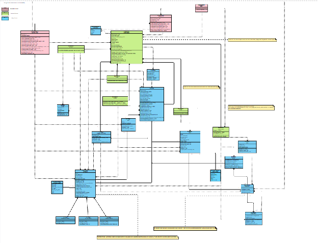
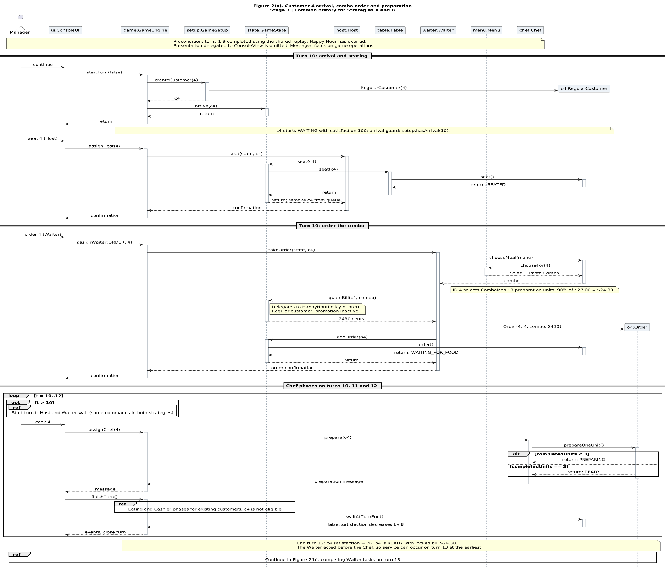
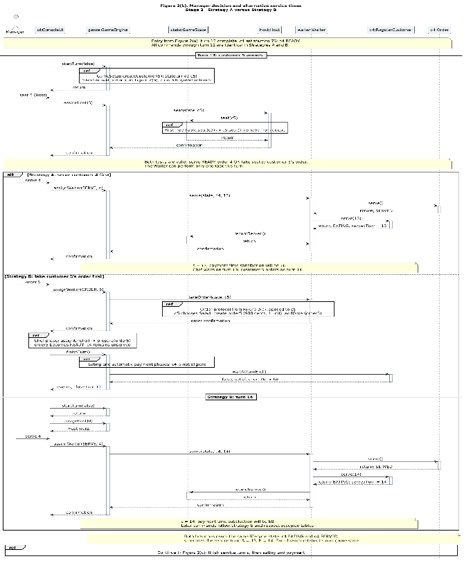
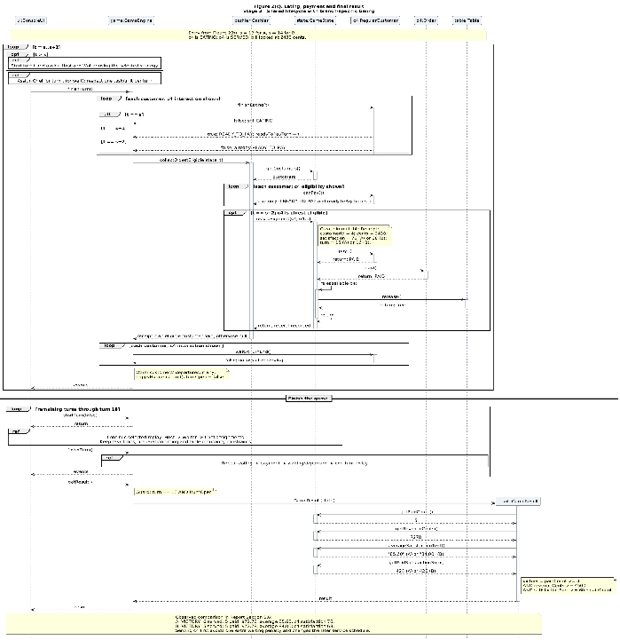

# Diagrams shown in Segment 7

The video uses two diagram subjects: the final Stage 3 class diagram, and the Customer 4 sequence scenario from the report. The sequence diagram is split into three connected images for readability.

## Stage 3 class diagram

[Open the class diagram](class-diagram.png)

## Customer 4 sequence diagram

This is the same turn-13 decision as Segment 2. Customer 4 chooses the Salad and Pasta combo for $24.30. Preparation occurs on turns 10, 11 and 12. Strategy A serves customer 4 on turn 13 and receives payment on turn 15; Strategy B takes customer 5's order first, serves customer 4 on turn 14 and receives payment on turn 16. Customer 4's payment-time satisfaction is 76 in A and 68 in B.

### Part A — arrival, order and preparation

### Part B — alternative manager decisions on turn 13

### Part C — eating, payment and final result

Replay inputs: [Strategy A](../../stage-3/examples/victory.txt) and [Strategy B](../inputs/strategy-b.txt). Segment 3 demonstrates Customer 1's Burger on turns 1–4.

The diagrams show the object structure and interactions behind the reproducible demonstrations.
